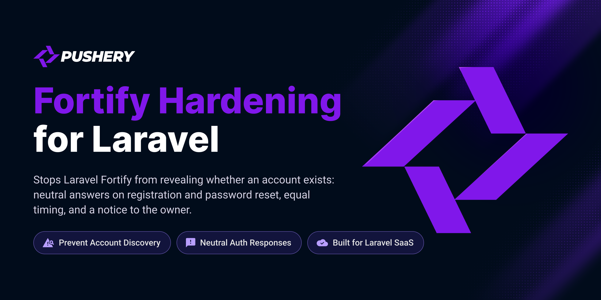

<p align="center">
  <a href="https://github.com/pushery/fortify-hardening-for-laravel">
    
  </a>
</p>

# Fortify Hardening for Laravel

[](https://packagist.org/packages/pushery/fortify-hardening-for-laravel)
[](https://packagist.org/packages/pushery/fortify-hardening-for-laravel)
[](https://packagist.org/packages/pushery/fortify-hardening-for-laravel)
[](LICENSE)

[](https://pestphp.com)


[](https://phpstan.org)
[](https://laravel.com/docs/pint)

Stops Laravel Fortify from revealing whether an account exists: neutral answers on registration and password reset, equal timing, and a notice to the owner.

## Documentation

**Full documentation at
[docs.pushery.com/fortify-hardening-for-laravel](https://docs.pushery.com/fortify-hardening-for-laravel/).**
This README is the quick start; the guides, the configuration reference and the
upgrade notes live there.

## Requirements

- PHP 8.4+
- Laravel 13+
- Laravel Fortify 1.34.1+, with its `registration` and `resetPasswords` features

Tested on PostgreSQL and MySQL 8.4, the databases Laravel Cloud runs (serverless Postgres
and MySQL 8.4 LTS), so it runs there out of the box. The fast suite runs on SQLite.

Tested on **PHP 8.4** — the floor of the declared range, because a `>=` promise is
only proven by running on the boundary — and on **PHP 8.5**, so the upper half of
`^8.4` is exercised here rather than first by a consumer.

## Installation

```bash
composer require pushery/fortify-hardening-for-laravel
```

The service provider is registered automatically through package discovery.

## What it changes

Fortify tells anyone who asks whether an email address has an account: its registration form
refuses a taken address, its reset-link form refuses an unknown one, and a password reset names the
difference too. With the package installed, Fortify's own routes answer every case alike.

| Where | Fortify on its own | With the package |
|---|---|---|
| Registration | a taken address is refused, a free one is signed in | both read "check your inbox", nobody is signed in, the holder of a taken address gets a notice |
| Reset link | an unknown address is refused, a recent one is told to wait | every request reads like a link that was sent |
| Password reset | an unknown address and a wrong token give different errors | every failure reads like a wrong token |
| Timing | a taken address answers sooner, a known one takes longer on the password routes | both answers take the same time |

Nothing needs to be wired: the package puts its answers in place of Fortify's through the
container. Give new accounts a verification mail (`MustVerifyEmail` on the user model) and show
`session('status')` on the sign-in page, and the registration reads the same for everybody. The
[installation guide](https://docs.pushery.com/fortify-hardening-for-laravel/installation) has the
details, and every setting is listed in the
[configuration reference](https://docs.pushery.com/fortify-hardening-for-laravel/configuration).

## Usage

On Fortify's route there is nothing to call. An application that registers users in a controller of
its own uses the registrar, which looks the address up, creates the account or sends the notice,
and signs nobody in:

```php
use App\Models\User;
use Pushery\FortifyHardening\Registration\Registrar;

public function store(RegisterRequest $request, Registrar $registrar): RedirectResponse
{
    $registrar->register(
        $request->string('email')->value(),
        $request->string('password')->value(),
        fn (string $hashedPassword): User => User::create([
            'name' => $request->string('name')->value(),
            'email' => $request->string('email')->value(),
            'password' => $hashedPassword,
        ]),
    );

    return redirect()->route('login')
        ->with('status', __('fortify-hardening::messages.registration.accepted'));
}
```

The [registration guide](https://docs.pushery.com/fortify-hardening-for-laravel/registration)
covers the form request, the notice to the holder and its mail budget.

To prove the property in your own suite, use the assertion the package ships:

```php
use Illuminate\Testing\TestResponse;
use Pushery\FortifyHardening\Testing\AssertsEnumerationSafety;

uses(AssertsEnumerationSafety::class);

it('answers an unknown address like a known one', function () {
    User::factory()->create(['email' => 'known@example.com']);

    $this->assertEnumerationSafe(
        fn (string $email): TestResponse => $this->post('/forgot-password', ['email' => $email]),
        'known@example.com',
        'unknown@example.com',
    );
});
```

See [Testing your application](https://docs.pushery.com/fortify-hardening-for-laravel/testing) for
registration and password reset examples.

## Testing

```bash
composer test
```

The PostgreSQL and MySQL suites need a reachable server and **skip** without one, so
a green run on a bare checkout has not exercised them, and the summary counts each of
their cases as skipped. Point them at a server with the `PG_TEST_*` / `MYSQL_TEST_*` variables
(defaults: `127.0.0.1`, ports 5432 and 3308, users `postgres` / `root`), and set
`REQUIRE_DB_TESTS=1` to turn an unreachable server into a failure instead of a skip.

```bash
REQUIRE_DB_TESTS=1 composer test
```

## Security

Please review the [security policy](SECURITY.md) and report vulnerabilities
privately rather than opening a public issue.

## Built by Pushery

This package is built and maintained by [Pushery](https://www.pushery.com) — a
Berlin-based studio building Laravel applications, SaaS products, and open-source
tools.

Building a Laravel UI? [WireKit](https://www.wirekit.app) is Pushery's open-source
Livewire component kit.
Browse the rest of our work at [pushery.com](https://www.pushery.com).

## License

The MIT License (MIT). See [LICENSE](LICENSE) for details.
